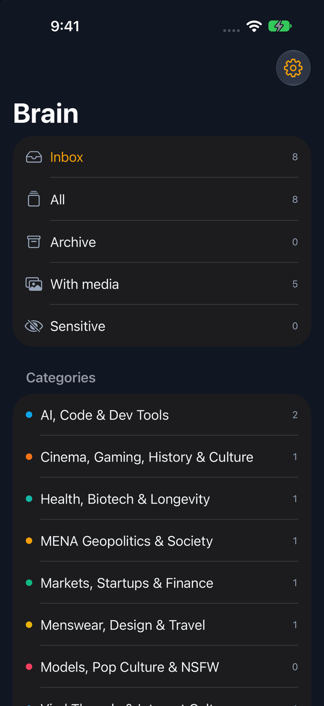

# Brain

Brain is a digital brain: one private place for everything you save. It pulls in
X bookmarks, Instagram saves, screenshots, Feedly articles and YouTube videos, and keeps
all of it. Nothing is thrown away.

Claude Haiku reads each new item and gives it:

- one of 8 categories
- a sub-topic inside that category
- a one-line summary in English
- 2 to 4 tags
- its language (English or Arabic)
- a sensitive flag

You can then search, filter, read, archive, change the category or tags, add a note, and
add items by hand. Arabic text shows right to left.

The full design is in [docs/second-brain-plan.html](docs/second-brain-plan.html).

## What it looks like

The screenshots below use sample data on a local copy of the app.


*The inbox. Each card shows who posted it, the sub-topic, the text, Claude's summary,
pictures, your note, the category and tags. The colored top edge is the category.*


*One category, picked from the side menu. Arabic posts read right to left.*


*An item page: open the original, archive it, write a note, change the category, add or
remove tags.*


*Sources: Claude sorting with a "Sort now" button, then each source with its status and
setup steps.*

<p>
  
  
</p>

*On a phone the side menu slides in from the left.*

## Categories

| Category | What goes in it |
| --- | --- |
| AI, Code & Dev Tools | LLMs, agents, prompts, coding tools, open source, Mac utilities |
| Markets, Startups & Finance | SaaS, venture capital, investing, macro and oil, MENA fintech |
| MENA Geopolitics & Society | Egypt, Jordan, the Gulf, Palestine, investigative threads |
| Cinema, Gaming, History & Culture | Film, games, books, history, art, calligraphy |
| Health, Biotech & Longevity | Health, fitness, sleep, nutrition, biotech |
| Menswear, Design & Travel | Tailoring, style, architecture, design, places to go |
| Viral Threads & Internet Culture | Memes, viral stories, social commentary, humor |
| Models, Pop Culture & NSFW | Celebrities, models, pop culture, sensitive content |

The categories live in the `categories` table, so you can rename or add them.

## The web app

The app is in `web/`. It is a Next.js 15 app that runs on Cloudflare Workers through
OpenNext.

- **Data:** Cloudflare D1 (SQLite), database `digital-brain`. The schema is in
  `db/migrations/`. Search uses an FTS5 index over the title, note, summary, author,
  handle and text. It handles English and Arabic alike, and matches word starts.
- **Files:** photos and screenshots go in R2, bucket `digital-brain-files`, and are served
  at `/files/<id>` only to you and your iPhone app.
- **Sign in:** Better Auth with email and password, plus Google (and Apple) when their
  keys are set. The archive is private: `ALLOWED_EMAILS` lists who may make an account.
  Without it, only the first account can be made.
- **One link, one item:** the same link saved from two places becomes one item with two
  saves, so you can see every place you saved it.

What you can do in it:

- **Inbox, All, Archive:** new items land in the inbox. Mark them read or archive them.
- **Search** by word, @handle or topic, in English or Arabic.
- **Filter** by category, tag or source, by language (English or Arabic), by media (with
  pictures or text only) and by the sensitive flag. Sensitive pictures are blurred until
  you turn the blur off.
- **Grid or list** layout.
- **Item page:** read the full text and pictures, see where and when you saved it, write a
  note, set the category, add or remove tags. Tags you add look different from the ones
  Claude suggests.
- **Add by hand** at `/add`: a link (the title and picture are filled in from the page), a
  note, tags, and a photo or file up to 10 MB.

## Sources

Each source shows its status on the Sources page (`/sources`).

| Source | How it connects today |
| --- | --- |
| X | Click Connect X on the Sources page. Brain pulls new bookmarks from the X API on Sync now and every six hours, and stops at the first page it has already seen. Older bookmarks can come from an export file with `npm run import:x` (see below). |
| Feedly | Each article you save for later reaches Brain through an IFTTT webhook. The Sources page shows the link and the body to paste into IFTTT. |
| YouTube | Its own Google connection with read-only YouTube access. Tick Liked videos and any of your playlists on the Sources page, and Brain brings in those, then checks again every six hours. Needs the Google keys. |
| Instagram | Upload Instagram's "Download your information" export (the zip or `saved_posts.json`) on the Sources page. Instagram gives only the link, the account and the date. You can also share a post to Brain from the iPhone share sheet. |
| Screenshots | The iPhone app sends your Screenshots album. Claude looks at each picture to sort it. |
| Added by hand | The `/add` page, or "Save to Brain" in any iPhone app. |

Feedly and other tools post to `/api/ingest/<source>?key=...`. The key is made for you
and shown on the Sources page. Keep it private.

### Import X bookmarks you already exported

The older `x-bookmark-manager` and `x-bookmarks-review` repos hold JSON exports. Import
one or both. Running it again is safe: bookmarks already there are skipped.

```sh
cd web
npm run import:x -- ../../x-bookmark-manager/bookmarks_export.json ../../x-bookmarks-review/bookmarks_db.json
```

Add `--remote` to load them into the real D1 database, and `--status read` to keep them
out of the inbox.

## Claude sorting

Claude Haiku sorts items in batches of 20. It reuses sub-topics already in use so they
stay tidy, and it never overwrites a category, sub-topic or summary you already have.

- New items from Feedly, the `/add` page, the share sheet and screenshots are sorted as
  they arrive.
- **Sort now** on the Sources page sorts everything still unsorted and shows progress.
- A timer in `web/worker.ts` runs every six hours. It syncs YouTube, then sorts up to 10
  batches of unsorted items.

Sorting needs the `ANTHROPIC_API_KEY` Worker secret. Without it, items still save, and
the Sources page says "Needs API key".

## The iPhone app

The app is in `ios/`. It is a SwiftUI app built with XcodeGen, with a share extension
called **Save to Brain** that saves a link, text or picture from any app.

The phone keeps its own data: one SQLite file with full-text search, backed up by iPhone
and iCloud Backup. You sign in with Google (Apple comes with a paid developer account). X bookmarks and the YouTube playlists
you pick come straight from X and YouTube, and Claude sorts new items with your own
Anthropic key. Settings can copy your saves from the web app once. See
[ios/README.md](ios/README.md) to build it.

<p>
  
  
  
  
  
</p>

Sign in, the inbox, the side menu, an item and Settings. The shots use made-up sample
data: debug builds launched with `-demo` skip sign in and fill Brain with it, and
`-screen menu|item|settings` opens on that screen.

## Deploys

GitHub is the source of truth. Merge to `main` and it goes live.

- `.github/workflows/deploy.yml` runs on every push to `main`. It applies new D1
  migrations to the real database, then builds and deploys the Worker. It needs a
  `CLOUDFLARE_API_TOKEN` repository secret (Edit Cloudflare Workers template, plus D1
  Edit).
- `.github/workflows/web.yml` runs lint, a typecheck and a build on every pull request.

Set Worker secrets once from `web/`:

```sh
cd web
npx wrangler secret put NAME
```

| Secret | What it is |
| --- | --- |
| `BETTER_AUTH_SECRET` | Long random string that signs sessions. Also guards the six-hourly timer. |
| `ALLOWED_EMAILS` | Who may make an account, comma separated. Unset means only the first account. |
| `ANTHROPIC_API_KEY` | Turns on Claude sorting. |
| `GOOGLE_CLIENT_ID`, `GOOGLE_CLIENT_SECRET` | Optional. Shows "Continue with Google" and lets you connect YouTube. |
| `APPLE_CLIENT_ID`, `APPLE_CLIENT_SECRET`, `APPLE_APP_BUNDLE_ID` | Optional. Shows "Continue with Apple". |

`BETTER_AUTH_URL` is not a secret. It is set in `web/wrangler.jsonc`.

Redirect URLs to add in Google and Apple:

- `https://<your app>/api/auth/callback/google` (Google sign in)
- `https://<your app>/api/youtube/callback` (YouTube)
- `https://<your app>/api/auth/callback/apple` (Apple sign in)

## Run it locally

You need Node 20 or later. Wrangler keeps a local copy of D1 and R2 in `web/.wrangler`.

```sh
cd web
npm install
cp .dev.vars.example .dev.vars   # then set BETTER_AUTH_SECRET and ALLOWED_EMAILS
npm run migrate                  # makes the tables in the local D1 copy
npm run dev                      # http://localhost:3000
```

Open http://localhost:3000, sign up with an email from `ALLOWED_EMAILS`, and add items at
`/add`. Add `ANTHROPIC_API_KEY` to `.dev.vars` to try sorting. Never commit `.dev.vars`.

Other scripts:

| Script | What it does |
| --- | --- |
| `npm run preview` | Builds the real Worker and runs it at http://localhost:8787 |
| `npm run lint` | ESLint |
| `npm run build` | Next.js build |
| `npm run migrate:remote` | Applies migrations to the real D1 database |
| `npm run deploy` | Builds and deploys by hand (the GitHub workflow does this for you) |
| `npm run cf-typegen` | Rebuilds the binding types in `cloudflare-env.d.ts` |

## Repo layout

```
.
├── web/                     Next.js app on Cloudflare Workers
│   ├── src/app/(app)/       Pages: list, item, add, sources
│   ├── src/app/api/         Sign in, ingest hook, timer, YouTube, iPhone app API
│   ├── src/components/      Cards, side menu, forms
│   ├── src/lib/             Database, sorter, sources, auth
│   ├── scripts/import-x.ts  X export import
│   ├── worker.ts            Worker entry and six-hourly timer
│   └── wrangler.jsonc       D1, R2 and timer settings
├── db/migrations/           D1 schema, applied in name order
├── ios/                     iPhone app and "Save to Brain" share extension
├── docs/                    Design doc and README screenshots
└── .github/workflows/       Deploy on merge, checks on pull requests
```
